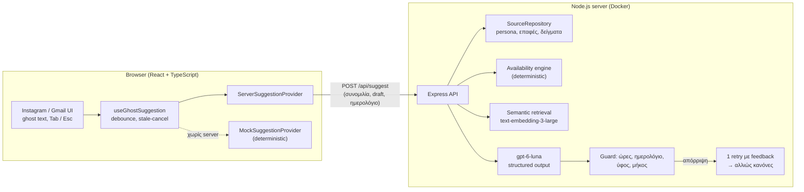

# AI: Your Digital Self · NTUA Lipa

**Netcompany Hackathon Athens 2026 · Challenge 1 · AI: Your Digital Self**

Ένας ψηφιακός δίδυμος που γράφει **όπως εσύ, ανάλογα με το σε ποιον μιλάς**. Η ίδια πρόθεση, για παράδειγμα «δεν μπορώ τότε», διατυπώνεται αλλιώς προς φίλη, προς συμφοιτητή και προς καθηγήτρια. Ο δίδυμος λαμβάνει υπόψη το ιστορικό της συζήτησης, πραγματικά δείγματα του τρόπου γραφής σου και το ημερήσιο πρόγραμμά σου.

Ο δίδυμος **δεν στέλνει τίποτα μόνος του**. Η πρόταση εμφανίζεται ως αχνό «ghost text» μέσα στο πεδίο απάντησης. Ο χρήστης πατά `Tab` για αποδοχή ή `Esc` για απόρριψη. Κάθε πρόταση δείχνει γιατί προτάθηκε: τι κατάλαβε ο δίδυμος, ποια δείγματα ύφους χρησιμοποίησε, ποιο γεγονός του ημερολογίου επηρέασε την απάντηση και ποιους ελέγχους ασφαλείας πέρασε.

## Γρήγορη εκκίνηση με Docker

Χρειάζεσαι Docker Desktop (ή Docker Engine με Compose v2.24+) και έναν browser (Chrome).

```bash
git clone https://github.com/Panayiotiswp6/NTUA-LIPA.git
cd NTUA-LIPA
cp .env.example .env    # προαιρετικό: OPENAI_API_KEY + AI_ENABLED=true για AI
docker compose up --build -d
```

Άνοιξε το **http://localhost:3000**.

- **Το AI είναι σε παύση από προεπιλογή**, για να προστατευτεί το περιορισμένο API allowance της ομάδας. Ακόμα κι αν υπάρχει key, το OpenAI δεν καλείται, και πάνω δεξιά εμφανίζεται «AI · σε παύση».
- **Με `OPENAI_API_KEY` και `AI_ENABLED=true`** στο `.env`: οι προτάσεις γράφονται από το `gpt-6-luna`, με semantic retrieval μέσω `text-embedding-3-large`. Πάνω δεξιά εμφανίζεται «AI · gpt-6-luna».
- **Χωρίς key**: η εφαρμογή λειτουργεί κανονικά και offline, με τους deterministic κανόνες, και εμφανίζει «Offline · κανόνες». Το demo δεν σπάει ποτέ λόγω δικτύου, κόστους ή διαθεσιμότητας του API.

Τερματισμός: `docker compose down`.

## Δοκιμή σε ένα λεπτό

1. Το Instagram ανοίγει με νέο DM από τη Μαρία: «πάμε για καφέ τη Δευτέρα στις 10:00;». Στο πεδίο απάντησης εμφανίζεται αχνή πρόταση που **αρνείται**, επειδή υπάρχει μάθημα 08:45–10:30, γραμμένη στο χαλαρό ύφος που χρησιμοποιεί ο ιδιοκτήτης με τη Μαρία.
2. Πάτησε **Tab** για να γίνει η πρόταση επεξεργάσιμο κείμενο. Ή ξεκίνα να γράφεις μόνος σου, π.χ. `Ναι` ή `αχ ρε`: ο δίδυμος συνεχίζει **το δικό σου κείμενο**.
3. Πάτησε **Why this suggestion?**. Εμφανίζονται τι κατάλαβε ο δίδυμος, τα δείγματα ύφους με το similarity score τους και οι έλεγχοι ασφαλείας. Το κυκλικό **i** δείχνει το γεγονός του ημερολογίου, τις ώρες και το event ID.
4. Άνοιξε το **Control Center**, διάλεξε «A professor» και πάτησε **Inject message**. Το ύφος γίνεται επίσημο: πληθυντικός ευγενείας, χωρίς emoji, με υπογραφή.
5. Άνοιξε το **Calendar**, άλλαξε μια ώρα ή απενεργοποίησε ένα μάθημα, και η πρόταση αλλάζει αμέσως.
6. Γράψε δικό σου εισερχόμενο μήνυμα στο Control Center. Ο δίδυμος καταλαβαίνει ελεύθερο κείμενο, όχι μόνο τα έτοιμα σενάρια.

## Πώς δουλεύει



Ο δίδυμος είναι **υβριδικός**, και αυτή είναι η βασική σχεδιαστική απόφαση:

| Ερώτημα | Ποιος αποφασίζει | Γιατί |
|---|---|---|
| Είμαι διαθέσιμος τη Δευτέρα στις 10:00; | **Deterministic engine** πάνω στο ημερολόγιο | Τα γεγονότα πρέπει να είναι σωστά και να ελέγχονται. Ένα LLM δεν πρέπει να «μαντεύει» το πρόγραμμα. |
| Τι ζητά ο άλλος; Πώς θα το έλεγα εγώ σε αυτόν; | **gpt-6-luna**, με τα πιο σχετικά δείγματα ύφους | Η κατανόηση ελεύθερου κειμένου και η μίμηση ύφους είναι αυτό στο οποίο υπερέχει ένα LLM. |
| Μπορεί αυτή η πρόταση να εμφανιστεί; | **Guard** (deterministic) | Χωρίς επινοημένες ώρες, χωρίς αντίφαση με το ημερολόγιο, χωρίς emoji προς καθηγήτρια. |

Η ροή μιας πρότασης:

1. **Context.** Ο browser στέλνει μόνο την κατάσταση της συνομιλίας: κανάλι, επαφή, ιστορικό, draft και ημερολόγιο. Το προφίλ ύφους και τα δείγματα φορτώνονται στον server από το `SourceRepository`.
2. **Ημερολόγιο.** Το `resolveAvailability` αναλύει ελληνικές ημέρες και ώρες και βγάζει απόφαση: `conflict`, `tentative`, `available` ή `clarify`, με τα ακριβή γεγονότα.
3. **Retrieval.** Τα δείγματα γραφής του ιδιοκτήτη προς τη συγκεκριμένη επαφή γίνονται embeddings μία φορά. Για κάθε μήνυμα επιλέγονται τα 3 πιο σχετικά. Δείγματα άλλων προσώπων δεν χρησιμοποιούνται ποτέ.
4. **Generation.** Το `gpt-6-luna` λαμβάνει persona, σχέση, χαρακτηριστικά ύφους, τα δείγματα, το ιστορικό και την απόφαση του ημερολογίου ως δεσμευτικό κανόνα. Επιστρέφει JSON με structured output: `understanding`, `intent`, `reply`, `usedSourceIds`, `confidence`.
5. **Guard.** Deterministic έλεγχοι στην απάντηση. Αν αποτύχουν, γίνεται μία επανάληψη με τα προβλήματα ως feedback, και αν αποτύχει ξανά απαντούν οι κανόνες. Η απόρριψη και ο λόγος της φαίνονται στο «Why this suggestion?».
6. **Autocomplete.** Όταν ο χρήστης γράφει πάνω στην πρόταση, η συνέχεια υπολογίζεται τοπικά χωρίς νέα κλήση. Όταν αποκλίνει, ο server ζητά από το μοντέλο **μόνο τη συνέχεια** με reasoning `none`, για χαμηλό latency, και αφαιρεί ό,τι επαναλαμβάνει το draft.

## Μέτρηση πιστότητας

Το `npm run eval` κάνει leave-one-out αξιολόγηση. Για κάθε δείγμα, ο δίδυμος βλέπει μόνο το μήνυμα της επαφής, ενώ η πραγματική απάντηση του ιδιοκτήτη κρύβεται από το repository και το retrieval. Τελευταία εκτέλεση (18 δείγματα, [πλήρης αναφορά](docs/EVALUATION.md)):

| Σύστημα | Ομοιότητα ύφους | Blind «σε ποιον απευθύνεται;» | Σωστό register |
|---|---:|---:|---:|
| **Digital Self** (gpt-6-luna + retrieval) | **0.657** | **100%** | **100%** |
| Generic gpt-6-luna, χωρίς persona | 0.538 | 39% | 78% |
| Deterministic κανόνες (offline) | 0.655 | 100% | 100% |

Το ίδιο μοντέλο χωρίς persona γράφει «γενικά», και ένας τυφλός ταξινομητής δεν καταλαβαίνει σε ποιον απευθύνεται (39%, κοντά στο 33% της τύχης). Με persona και retrieval, κάθε απάντηση αναγνωρίζεται σωστά. Οι κανόνες έχουν γραφτεί πάνω στα ίδια δείγματα, άρα το σκορ τους είναι αισιόδοξο. Όμως μόνο το LLM καταλαβαίνει ελεύθερα μηνύματα που δεν καλύπτουν οι κανόνες.

## Ιδιωτικότητα, ασφάλεια και κόστος

- **Συνθετικά δεδομένα.** Όλα τα πρόσωπα, emails, συνομιλίες και πορτρέτα είναι πλασματικά. Τα πορτρέτα είναι AI-generated και αποθηκεύονται τοπικά. Δεν συνδέεται με πραγματικό Instagram, Gmail ή ημερολόγιο.
- **Το API key μένει στον server.** Διαβάζεται μόνο από το `.env` του container, ποτέ από μεταβλητή `VITE_*` ή από το browser bundle. Το `.env` αγνοείται από το git. Το `/api/health` λέει μόνο αν το AI είναι ενεργό.
- **Data minimisation.** Ο browser δεν στέλνει προφίλ ούτε δείγματα, και ο server δεν αποθηκεύει συνομιλίες. Οι αλλαγές ημερολογίου ζουν στη μνήμη της συνεδρίας.
- **Ο χρήστης έχει τον έλεγχο.** Τίποτα δεν στέλνεται χωρίς ρητή αποδοχή και αποστολή. Το ghost text δεν είναι draft.
- **Παύση AI.** Το `AI_ENABLED` είναι `false` από προεπιλογή, οπότε το key αγνοείται μέχρι να ενεργοποιηθεί ρητά. Για να ενεργοποιηθεί για όλους, η σταθερά `AI_ENABLED_BY_DEFAULT` στο `server/config.ts` γίνεται `true`.
- **Όρια κόστους.** Υπάρχει token budget ανά διεργασία (`AI_TOKEN_BUDGET`) και rate limit (`AI_RATE_LIMIT_PER_MINUTE`). Πάνω από αυτά απαντούν οι κανόνες. Υπάρχουν επίσης cache ίδιων αιτημάτων, cache embeddings και τοπικό autocomplete όσο ο χρήστης ακολουθεί την πρόταση.

## Τοπική ανάπτυξη χωρίς Docker

Node.js 22+:

```bash
cd digital-twin-demo
npm ci
npm run dev:server   # API στο :3000, διαβάζει το ../.env αν υπάρχει
```

```bash
cd digital-twin-demo
npm run dev          # Vite στο :5173, προωθεί το /api στο :3000
```

```bash
cd digital-twin-demo
npm test             # 63 tests: UI, hook, domain, ημερολόγιο, server contract, provider
```

```bash
cd digital-twin-demo
npm run typecheck && npm run build:all
```

```bash
cd digital-twin-demo
npm run eval         # χρειάζεται OPENAI_API_KEY· γράφει το docs/EVALUATION.md
```

Το GitHub Pages ([live](https://panayiotiswp6.github.io/NTUA-LIPA/)) δημοσιεύει τη στατική έκδοση. Χωρίς server, εκεί απαντούν αυτόματα οι deterministic κανόνες.

## Δομή

| Διαδρομή | Περιεχόμενο |
|---|---|
| `docker-compose.yml`, `digital-twin-demo/Dockerfile` | Ένα container: build του web app και του API, εκτέλεση ως non-root, healthcheck |
| `digital-twin-demo/server/` | API (`app.ts`), υβριδική λογική (`suggestionService.ts`), prompts, retrieval, guard, budget, `eval.ts` |
| `digital-twin-demo/src/ai/` | `ServerSuggestionProvider`, επιλογή provider, κατάσταση AI |
| `digital-twin-demo/src/domain/` | Τύποι και contracts, συνθετικά δεδομένα, deterministic provider, μηχανή ημερολογίου |
| `digital-twin-demo/src/App.tsx` | Instagram, Gmail, Control Center, Sources, Calendar |
| `docs/PROJECT_CONTEXT.md` | Σταθερές αποφάσεις της ομάδας |
| `docs/EVALUATION.md` | Αποτελέσματα του `npm run eval` |

Περισσότερες λεπτομέρειες για το UI και το ημερολόγιο: [digital-twin-demo/README.md](digital-twin-demo/README.md).

## Επόμενα βήματα (δεν έχουν υλοποιηθεί)

- Εισαγωγή πραγματικών, συναινετικών συνομιλιών του ιδιοκτήτη μέσω νέου `SourceRepository`, χωρίς αλλαγές στο UI, και επανάληψη του `npm run eval` πάνω σε αυτές.
- Πραγματικό calendar connector, persistence, authentication και privacy controls ανά χρήστη.
- Browser extension που μετατρέπει την ενεργή συνομιλία σε `SuggestionContext` και καλεί τον ίδιο server.
