# AI: Your Digital Self · NTUA Lipa

**Netcompany Hackathon Athens 2026 · Challenge 1 · AI: Your Digital Self**

Ένας ψηφιακός δίδυμος που **μαθαίνει από τα δικά σου μηνύματα** πώς γράφεις, τι ξέρεις και πώς αποφασίζεις. Μετά προτείνει απαντήσεις που ακούγονται σαν εσένα, διαφορετικές για κάθε άνθρωπο, και **ποτέ δεν στέλνει τίποτα μόνος του**. Δεν είναι chatbot με persona prompt. Είναι ένα σύστημα που εισάγει το ψηφιακό σου αποτύπωμα, χτίζει ένα persona model που μπορείς να ελέγξεις, απαντά με βάση πραγματικές παρόμοιες περιπτώσεις και μετρά πόσο «εσύ» είναι.

## Εκτέλεση με μία εντολή

Χρειάζεσαι Docker Desktop, ή Docker Engine με Compose v2.24+, και Chrome.

```bash
git clone https://github.com/Panayiotiswp6/NTUA-LIPA.git
cd NTUA-LIPA
docker compose up --build -d
```

Άνοιξε το **http://localhost:3000**. Στην πρώτη εκκίνηση ο δίδυμος χτίζεται αυτόματα από τα συνθετικά δεδομένα του demo, μέσα από το ίδιο pipeline εισαγωγής που χρησιμοποιεί και ο χρήστης.

**Προαιρετικά, για live AI:** δημιούργησε ένα `.env` δίπλα στο `docker-compose.yml`:

```bash
OPENAI_API_KEY=το-key-σας
AI_ENABLED=true
```

Χωρίς αυτό, η εφαρμογή λειτουργεί **πλήρως offline** με τον δικό μας κώδικα ανάλυσης, και πάνω δεξιά γράφει «AI · σε παύση» ή «Offline». Το AI είναι κλειστό από προεπιλογή, για να προστατεύεται το περιορισμένο API allowance της ομάδας. Τερματισμός: `docker compose down`. Πλήρης διαγραφή δεδομένων: `docker compose down -v`.

## Τι θα δεις (τα 4 ζητούμενα του brief)

Πάτησε **Digital Twin** στην πάνω μπάρα.

| Ζητούμενο | Οθόνη | Τι δείχνει |
|---|---|---|
| **Working prototype**: εισάγει αποτύπωμα και χτίζει δίδυμο | **Import** | Drag & drop των επίσημων εξαγωγών από WhatsApp (.zip/.txt), Telegram (result.json), Gmail (Takeout .mbox), Instagram/Messenger (JSON) και σημειώσεις (.md, Obsidian/Notion zip). Αυτόματη αναγνώριση μορφής ακόμα και σε nested zip, πρόοδος ανά στάδιο, επιβεβαίωση «ποιος είσαι εσύ», σύνοψη ανά πηγή. |
| **Persona model** που μπορείς να ελέγξεις | **Persona** | Γνώσεις, Ύφος («η φωνή σου σε αριθμούς», σύγκριση ύφους φίλου/οικογένειας/σπουδών/επίσημου), Προτιμήσεις & συνήθειες, Αποφάσεις, Σχέσεις. Κάθε γεγονός έχει βεβαιότητα και αποδείξεις από τα μηνύματα. Επιβεβαίωσε, διόρθωσε ή απόρριψε το. |
| **Live demo**: από τα δεδομένα σε απαντήσεις και αποφάσεις | **Reply Studio** · **Ask my twin** · Instagram/Gmail | Εισερχόμενα από διαφορετικές πλατφόρμες και σχέσεις, και μερικά εντελώς άγνωστα. Για καθένα: πρόχειρο, αιτιολόγηση, παρόμοιες περιπτώσεις, βεβαιότητα, ταίριασμα ύφους, Edit → Approve. Σύγκριση **Γενικό AI vs ο δίδυμός σου**. Στο Ask: «Τι θα έλεγα αν…;» ή «Πότε πάω γυμναστήριο;» με παραπομπές. |
| **Approach & rationale**: πώς μαθαίνει, πώς μετράμε, πώς προστατεύουμε | **Fidelity Lab** · **Privacy** | Hold-out αξιολόγηση, blind τεστ «Ποιο έγραψα εγώ;», αποτελέσματα με AI, χρονολόγιο μάθησης. Redaction σε πραγματικό χρόνο, έλεγχος πηγών, εξαγωγή persona σε JSON, διαγραφή όλων. |

**Δοκιμή σε ένα λεπτό:**
1. **Persona → Αποφάσεις**: ο δίδυμος βρήκε μόνος του ότι «Όταν τον καλούν για έξοδο τελευταία στιγμή καθημερινή, συνήθως αρνείται και προτείνει το Σαββατοκύριακο», με τα μηνύματα-αποδείξεις.
2. **Reply Studio**: η Μαρία γράφει «πάμε για ποτό απόψε;» και ο δίδυμος αρνείται και προτείνει Σάββατο, με το ύφος που χρησιμοποιεί ο κάτοχος μαζί της. Ο Γιώργος γράφει σε greeklish και παίρνει απάντηση σε greeklish. Στην πρόταση για θέση στο Λονδίνο ο δίδυμος **απέχει**, γιατί δεν ξέρει τι θα έλεγε ο κάτοχος.
3. **Fidelity Lab**: παίξε το blind τεστ.
4. **Instagram / Gmail**: η αρχική προσομοίωση με inline ghost text (`Tab` για αποδοχή, `Esc` για απόρριψη) και έλεγχο ημερολογίου.

## Πώς μαθαίνει (αρχιτεκτονική)

```mermaid
flowchart LR
  subgraph Import["Import (δικός μας κώδικας)"]
    Z["Επίσημες εξαγωγές<br/>WhatsApp · Telegram · Gmail · Instagram · σημειώσεις"] --> D["Ασφαλές unzip<br/>zip-bomb / zip-slip"]
    D --> P["Parser plugins<br/>detect() → parse()"]
    P --> N["Dedupe · ποιος είμαι εγώ<br/>ζεύγη ερώτησης→απάντησης<br/>12% hold-out · σχέση"]
    N --> R["PII redaction<br/>ψευδώνυμα τρίτων"]
  end
  R --> DB[("SQLite σε Docker volume<br/>μόνο τοπικά")]
  DB --> S["Ανάλυση ύφους<br/>ανά περίσταση"]
  DB --> F["Persona facts με αποδείξεις<br/>κανόνες + προαιρετικά LLM"]
  subgraph Twin["Twin engine"]
    Q["Νέο μήνυμα"] --> REG["Περίσταση"]
    REG --> EX["Παρόμοιες περιπτώσεις<br/>BM25 + κατάσταση + πρόσωπο"]
    EX --> GEN{"AI ενεργό;"}
    GEN -- ναι --> LLM["LLM few-shot<br/>με redacted prompt"]
    GEN -- όχι --> OFF["Τα δικά σου λόγια<br/>από την ίδια κατάσταση"]
    LLM --> CHK["Guard + style scorer<br/>ή αποχή"]
    OFF --> CHK
  end
  S --> Twin
  F --> Twin
  CHK --> UI["Reply Studio · Ask · Instagram/Gmail<br/>ο χρήστης εγκρίνει"]
  UI -- "διορθώσεις" --> DB
```



**Σχεδιαστικές αποφάσεις:**
- **Ό,τι μπορεί να υπολογιστεί, το υπολογίζει ο δικός μας κώδικας.** Οι μετρικές ύφους, οι τρόποι απόφασης, οι σχέσεις, η ανάκτηση παρόμοιων περιπτώσεων, ο έλεγχος ύφους, το redaction και η αξιολόγηση δουλεύουν χωρίς LLM. Το LLM είναι επιπλέον στρώμα για διατύπωση και εμπλουτισμό, όχι ο πυρήνας.
- **Few-shot ανά κατάσταση, όχι persona prompt.** Η απάντηση βασίζεται σε πραγματικές περιπτώσεις «τι μου έγραψαν → τι απάντησα» από την ίδια κατάσταση (π.χ. πρόσκληση τελευταίας στιγμής καθημερινή) και την ίδια σχέση.
- **Τα γεγονότα τα αποφασίζει κώδικας.** Η διαθεσιμότητα βγαίνει από το ημερολόγιο. Ο guard απορρίπτει επινοημένες ώρες, αντιφάσεις με το ημερολόγιο και λάθος ύφος. Όταν ο δίδυμος δεν ξέρει, **απέχει**.
- **Μαθαίνει συνεχώς.** Κάθε νέα εισαγωγή ενημερώνει ύφος και γεγονότα, χωρίς να δημιουργεί διπλά μηνύματα. Κάθε διόρθωση στο Reply Studio γίνεται νέο παράδειγμα με μεγαλύτερο βάρος.

## Πώς μετράμε την πιστότητα

**1. Hold-out, offline (Fidelity Lab).** Το 12% των πραγματικών ζευγών «τι μου έγραψαν → τι απάντησα» δεν χρησιμοποιείται για ύφος, γεγονότα ή αναζήτηση. Συγκρίνουμε τον δίδυμο με μια εκδοχή **χωρίς persona**: ίδια αναζήτηση, αλλά χωρίς κατάσταση, σχέση και πρόσωπο. Demo persona, 24 κρυμμένες απαντήσεις:

| Μετρική (δικός μας κώδικας) | Δίδυμος | Χωρίς persona |
|---|---:|---:|
| Ίδια απόφαση με τον άνθρωπο (αρνείται / δέχεται / προτείνει άλλη μέρα…) | **87.5%** | 83.3% |
| Ταίριασμα με το μετρημένο ύφος του ανά περίσταση | **79.6%** | 76.2% |
| Blind: σωστή σχέση μόνο από το ύφος | **95.8%** | 91.7% |

**2. Με AI, leave-one-out** ([docs/EVALUATION.md](docs/EVALUATION.md), `gpt-6-luna` + `text-embedding-3-large`, 18 δείγματα):

| | Δίδυμος | Ίδιο μοντέλο χωρίς persona |
|---|---:|---:|
| Blind «σε ποιον απευθύνεται;» (τύχη: 33%) | **100%** | 39% |
| Σωστό ύφος (πληθυντικός ευγενείας / χαλαρό) | **100%** | 78% |
| Σημασιολογική ομοιότητα με την πραγματική απάντηση | **0.657** | 0.538 |

**3. Blind τεστ «Ποιο έγραψα εγώ;».** Ο κάτοχος βλέπει την πραγματική του απάντηση και του δίδυμου ανακατεμένες. Το ποσοστό σύγχυσης είναι το πιο κατανοητό μέτρο: 50% σημαίνει ότι ο δίδυμος δεν ξεχωρίζει από τον κάτοχο. Με ενεργό AI, το Fidelity Lab τρέχει και κριτή LLM με σταθερά κριτήρια: πρόθεση, ύφος, «θα το καταλάβαινε φίλος».

**Ειλικρινώς:** τα συνθετικά δεδομένα επαναλαμβάνουν φράσεις, οπότε πολλές απαντήσεις ταυτίζονται λέξη προς λέξη και το δείγμα είναι μικρό. Τα νούμερα δείχνουν κατεύθυνση, όχι benchmark, και πρέπει να ξαναμετρηθούν σε πραγματικά, συναινετικά δεδομένα.

## Ιδιωτικότητα και έλεγχος

- **Όλα τοπικά.** Τα δεδομένα μένουν σε SQLite μέσα σε Docker volume (`twin-data`). Δεν υπάρχει cloud βάση.
- **Μόνο redacted κείμενο φεύγει, και μόνο με ενεργό AI.** Πριν από κάθε κλήση σε μοντέλο, ολόκληρο το prompt περνά από redaction: τα ονόματα τρίτων γίνονται σταθερά ψευδώνυμα (`Person_A`), σε κάθε ελληνική πτώση. Αφαιρούνται emails, τηλέφωνα, IBAN, ΑΦΜ, ΑΜΚΑ, κάρτες και URLs με tokens. Τα ονόματα επανέρχονται τοπικά στην απάντηση.
- **Οι άλλοι είναι μόνο πλαίσιο.** Τα μηνύματα των άλλων δείχνουν μόνο σε τι απαντούσε ο κάτοχος. Δεν χρησιμοποιούνται για ύφος και δεν γίνονται γεγονότα για εκείνους.
- **Ο κάτοχος έχει τον έλεγχο.**
  - Επιβεβαίωση ή απόρριψη γεγονότων: τα απορριφθέντα δεν ξαναχρησιμοποιούνται.
  - Ενεργοποίηση ή εξαίρεση ανά πηγή, διαγραφή πηγής, διαγραφή όλων.
  - Εξαγωγή του persona σε JSON.
  - Καμία αυτόματη αποστολή.
- **Ασφάλεια εισόδου.**
  - Όρια μεγέθους.
  - Ασφαλές zip: όριο αρχείων και αναλογίας συμπίεσης, απόρριψη path traversal, ανάγνωση στη μνήμη.
  - Έλεγχος κάθε input του API.
  - Καμία καταγραφή περιεχομένου μηνυμάτων ή του key.
- **API key μόνο server-side**, στο `.env`, που αγνοείται από το git. Υπάρχουν token budget και rate limit.

## Ανάπτυξη και tests

Node.js 22+:

```bash
cd digital-twin-demo && npm ci
```

```bash
npm run dev:server   # API στο :3000 (διαβάζει το ../.env αν υπάρχει)
```

```bash
npm run dev          # Vite στο :5173, προωθεί το /api στο :3000
```

```bash
npm test             # 104 tests
```

```bash
npm run typecheck && npm run build:all
```

```bash
npx tsx scripts/generate-sample-data.ts   # αναπαράγει τα συνθετικά δεδομένα
```

Τα tests καλύπτουν:
- **Parsers:** ελληνικές ημερομηνίες, μηνύματα πολλών γραμμών, mojibake, quoted replies.
- **Ασφάλεια:** zip-slip, zip bomb, redaction, ανίχνευση greeklish.
- **Ανάλυση:** μετρικές ύφους, εξαγωγή γεγονότων.
- **Μηχανή:** τρόπος απόφασης, αποχή, μάθηση από διορθώσεις, συμβόλαια LLM με fake μοντέλο (π.χ. κανένα όνομα σε prompt).
- **Αξιολόγηση και API:** fidelity, blind τεστ, privacy API, τα 47 αρχικά tests του UI.

Το CI χτίζει και τρέχει το `docker compose up --build` σε κάθε push.

| Διαδρομή | Περιεχόμενο |
|---|---|
| `digital-twin-demo/server/twin/importers/` | Parser plugins και ασφαλές unzip |
| `digital-twin-demo/server/twin/ingest.ts` · `redact.ts` · `text.ts` | Pipeline εισαγωγής, redaction, ανίχνευση γλώσσας |
| `digital-twin-demo/server/twin/style.ts` · `persona.ts` | Μετρικές ύφους, style scorer, persona facts |
| `digital-twin-demo/server/twin/engine.ts` · `ask.ts` · `fidelity.ts` | Μηχανή απάντησης, Ask, αξιολόγηση |
| `digital-twin-demo/src/twin/` | Σελίδες του Digital Twin |
| `digital-twin-demo/scripts/generate-sample-data.ts` · `sample-data/` | Συνθετικό αποτύπωμα σε πραγματικές μορφές εξαγωγής |
| `docs/PROJECT_CONTEXT.md` | Σταθερές αποφάσεις της ομάδας |

## Περιορισμοί

- Δεν υπάρχουν live connectors (IMAP, Telegram API, browser extension) ούτε πολλαπλοί χρήστες ή authentication. Ο δίδυμος είναι για έναν τοπικό χρήστη.
- PDF και DOCX δεν υποστηρίζονται ακόμα· μόνο .md και .txt.
- Η ανάκτηση offline είναι λεξική και βασίζεται στην κατάσταση. Με ενεργό AI, η διατύπωση γίνεται από το μοντέλο.
- Τα αποτελέσματα πιστότητας αφορούν συνθετικά δεδομένα.
- Οι χρόνοι μετακίνησης δεν υπολογίζονται στη διαθεσιμότητα.
